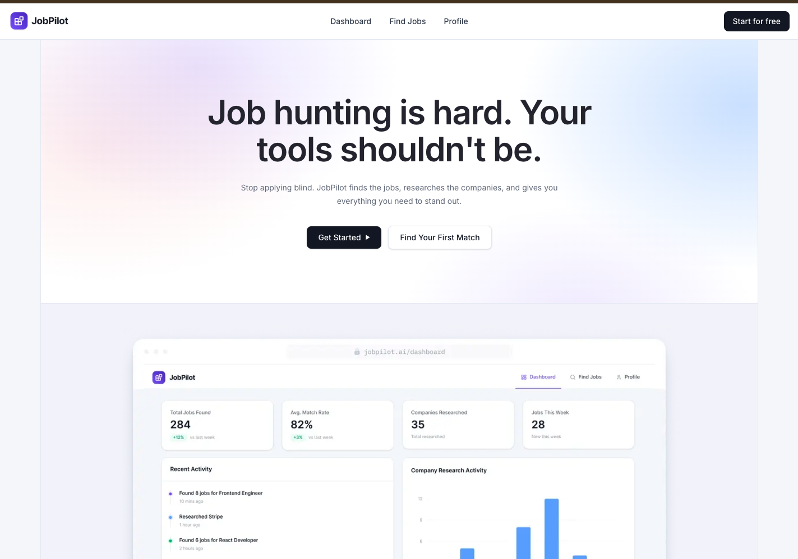
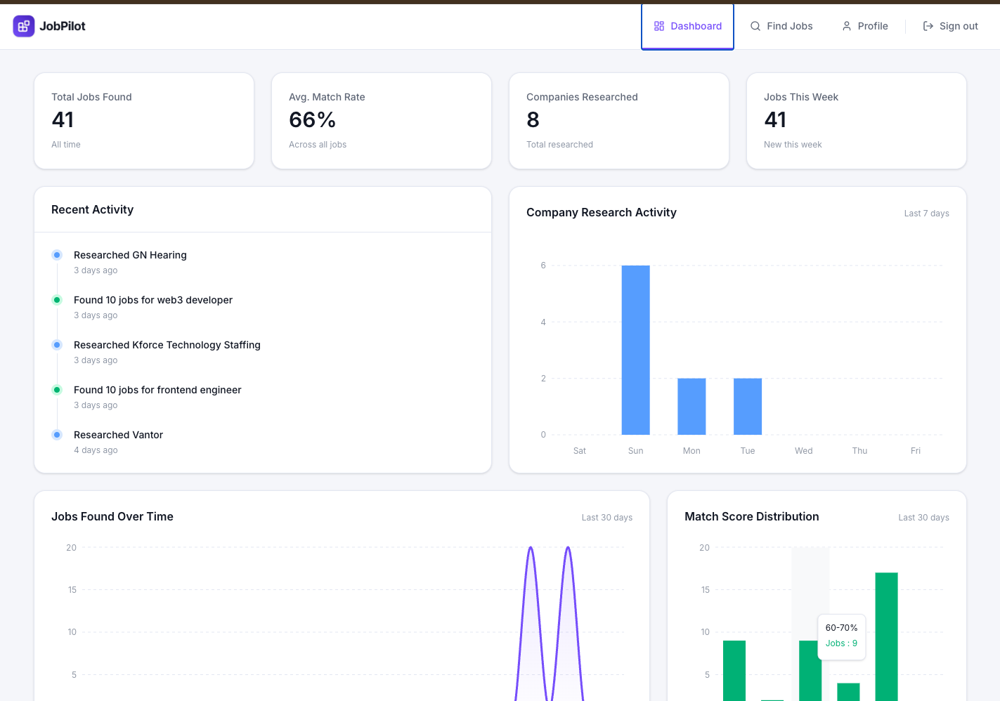
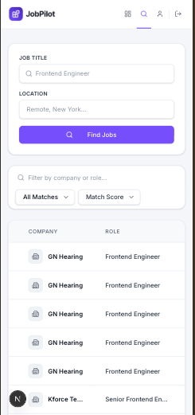
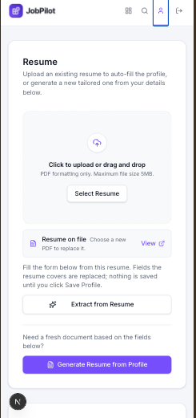

# JobPilot: AI Job Hunting Assistant

## Overview

JobPilot is a full-stack AI job hunting assistant built with Next.js, React, TypeScript, and Tailwind CSS. Set up your profile once, upload your resume, and JobPilot finds relevant jobs on Adzuna and scores each one against your skills with GPT-4o. For the roles you like, an AI agent browses the company's public web pages and builds a research dossier, then drafts a cover letter in the tone you choose.

You stay in control: JobPilot never submits an application for you. It does the preparation, and you decide where to apply.

## Screen Snapshots

<p float="left">
  
  
</p>

<p float="left">
  
  
</p>

1. **Landing page:** hero with a live preview of the dashboard and calls to action.
2. **Dashboard:** four stat cards, a recent activity feed, and PostHog-powered charts for jobs found, match score distribution, and company research.
3. **Find Jobs (mobile):** search by title and location, then filter and sort scored results.
4. **Profile (mobile):** upload a resume PDF, extract it into the profile form, or generate a fresh resume from your profile.

## Features

- Next.js 16 App Router app styled with Tailwind CSS 4 and written in TypeScript
- Landing page with hero, features, and call-to-action sections
- Google and GitHub sign-in through InsForge Auth, with route protection in `proxy.ts`
- Profile form covering personal info, work experience, education, and job preferences, with a completion indicator
- Resume PDF upload with optional "Extract from Resume" auto-fill powered by GPT-4o
- One-page resume PDF generation from your profile, rendered with `@react-pdf/renderer`
- Job discovery through the Adzuna API, limited to IT jobs
- GPT-4o job matching: a 0-100 score, a reason, matched skills, and missing skills for every job
- Find Jobs table with text filter, match filter, sort options, and 20-per-page pagination
- Job details page with structured posting data, skills comparison, and an Apply Now link
- Company Research agent: Stagehand drives a single Browserbase session through the company's public pages, then GPT-4o synthesizes a dossier (overview, tech stack, culture, why the role exists, and interview prep). It always returns a dossier, even when the company site cannot be reached
- Cover letter generation in a formal, casual, or enthusiastic tone, with editing, copy, and regenerate
- Streamed progress: every long AI action shows a live step checklist backed by real server stages
- Dashboard analytics from PostHog events, plus a recent activity feed
- Per-user rate limits on the paid AI routes
- Loading skeletons across all signed-in pages

## Tech Stack

| Area | Technology |
| --- | --- |
| Framework | Next.js 16, React 19, TypeScript |
| Styling | Tailwind CSS 4, Lucide icons |
| Auth, database, storage | InsForge (PostgreSQL, Google and GitHub OAuth, private file storage) |
| AI | OpenAI GPT-4o |
| Company research | Browserbase and Stagehand |
| Job data | Adzuna API |
| Charts | Recharts |
| PDF | `@react-pdf/renderer`, `pdf-parse` |
| Analytics | PostHog (event tracking and HogQL dashboard queries) |
| Validation | Zod |

## How It Works

1. A signed-in user completes their profile and optionally uploads a resume PDF.
2. **Find Jobs** calls the Adzuna API, skips jobs that are already saved, and scores each new job with GPT-4o against the saved profile.
3. **Research Company** opens one Browserbase session with Stagehand, visits the company homepage and its About, Blog, and Engineering pages, and has GPT-4o write the dossier into `jobs.company_research`.
4. **Generate Cover Letter** writes a letter from the job posting, the profile, and the dossier when one exists.
5. Long actions stream newline-delimited JSON events, so the browser shows each real stage as the server passes it.
6. PostHog events (`job_search_started`, `job_found`, `company_researched`, and others) feed the dashboard charts.

## Project Structure

```
app/
  page.tsx                  Landing page
  login/                    Google and GitHub sign-in
  (app)/                    Signed-in pages that share the app navbar
    dashboard/              Stats, recent activity, and charts
    find-jobs/              Search and jobs list (find-jobs/[id] is the job details page)
    profile/                Profile form and resume management
  api/
    agent/                  find, research, and cover-letter routes
    resume/                 upload, file, extract, and generate routes
    auth/                   OAuth callback, session refresh, and sign-out
agent/                      GPT-4o and Stagehand logic (matcher, research, cover letter, resume)
actions/                    Server Actions (auth, profile, cover letter edits)
components/                 UI by area (homepage, dashboard, find-jobs, job-details, profile, shared)
lib/                        InsForge clients, PostHog, Adzuna, rate limiting, progress streaming
db/migrations/              SQL schema, dashboard stats function, and cover letter columns
context/                    Product, architecture, and UI specs
proxy.ts                    Session refresh and protected-route redirects
```

## Getting Started

### Prerequisites

- Node.js 20 or later
- An [InsForge](https://insforge.dev) project with Google and GitHub OAuth enabled
- API keys for [OpenAI](https://platform.openai.com), [Adzuna](https://developer.adzuna.com), and [Browserbase](https://www.browserbase.com)
- A [PostHog](https://posthog.com) project (a personal API key is needed for the dashboard charts)

### Installation

```bash
npm install
```

### Environment variables

Create a `.env.local` file in the project root. `.env.example` lists the PostHog and site URL variables to start from.

```bash
# InsForge
NEXT_PUBLIC_INSFORGE_URL=
NEXT_PUBLIC_INSFORGE_ANON_KEY=

# OpenAI
OPENAI_API_KEY=

# Adzuna
ADZUNA_APP_ID=
ADZUNA_API_KEY=

# Browserbase (company research)
BROWSERBASE_API_KEY=
BROWSERBASE_PROJECT_ID=

# PostHog browser analytics
NEXT_PUBLIC_POSTHOG_PROJECT_TOKEN=
NEXT_PUBLIC_POSTHOG_HOST=

# PostHog dashboard charts (server-side reads, never prefix with NEXT_PUBLIC_)
POSTHOG_PERSONAL_API_KEY=
POSTHOG_PROJECT_ID=
POSTHOG_API_HOST=https://eu.posthog.com

# Public origin of the site (no trailing slash)
NEXT_PUBLIC_APP_URL=http://localhost:3000
```

### Database

Apply the SQL files in `db/migrations/` to your InsForge database, in order:

1. `001_initial_schema.sql` creates the tables, indexes, and row-level security policies.
2. `002_dashboard_stats.sql` adds the function behind the dashboard stat cards.
3. `003_cover_letters.sql` adds the cover letter columns to `jobs`.

Create a **private** storage bucket named `resumes`.

### Run the app

```bash
npm run dev
```

Open [http://localhost:3000](http://localhost:3000) with your browser to see the result.

## Scripts

| Command | Description |
| --- | --- |
| `npm run dev` | Start the Next.js dev server |
| `npm run build` | Build for production |
| `npm run start` | Run the production build |
| `npm run lint` | Lint with ESLint |

## Deployment

Deploy the app to [Vercel](https://vercel.com/new) and set the environment variables above, with `NEXT_PUBLIC_APP_URL` set to your public origin. The same value is used for the OAuth redirect, canonical URLs, share images, and the sitemap.

## Learn More

- [Next.js Documentation](https://nextjs.org/docs)
- [InsForge](https://docs.insforge.dev), [Stagehand](https://docs.stagehand.dev), [Browserbase](https://docs.browserbase.com), [PostHog](https://posthog.com/docs)
- [Adzuna API](https://developer.adzuna.com/overview) and [OpenAI API](https://platform.openai.com/docs)
